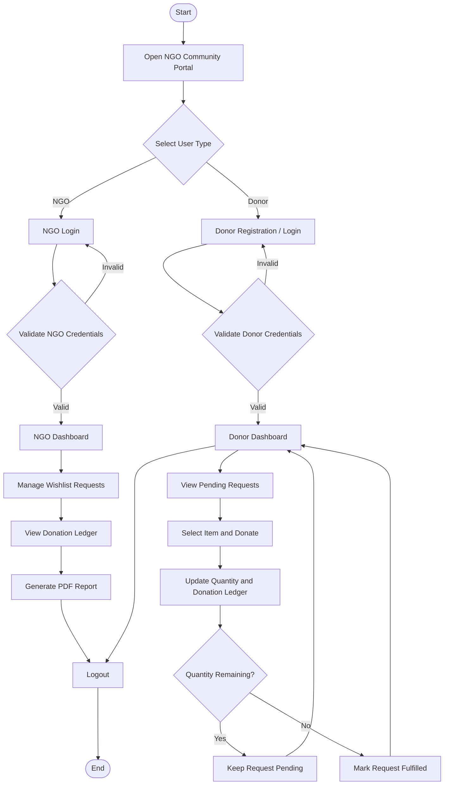
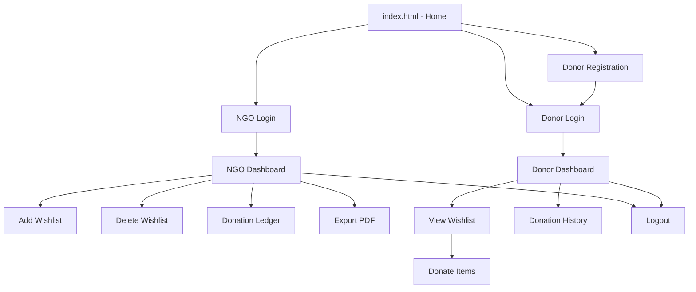

# Project Planning and Architecture Design

## Project Title: NGO Community Portal – Donation and Wishlist Management System

## 1. Project Overview

The NGO Community Portal is a web-based application developed using Python Flask, SQLite, HTML, CSS, and Bootstrap (assuming Bootstrap is used for the frontend).

The main objective of this project is to create a common platform where NGOs can publish their donation requirements and donors can contribute the required items.

The system provides two types of users:

- NGO (Administrator): Can log in, publish donation requests, monitor donations, manage wishlist items, and download donation reports in PDF format.
- Donor: Can register, log in, view available donation requests, donate items, and track their donation history.

The application maintains a centralized database to store user information, donation requests, and donation transactions.

## 2. Project Objectives

1. To connect NGOs and donors through a centralized online platform.
2. To allow NGOs to publish their current requirements.
3. To provide donors with a list of available items that need donations.
4. To maintain a record of all donation transactions.
5. To automatically update the remaining quantity after each donation.
6. To track pending and fulfilled donation requests.
7. To generate downloadable PDF donation reports.
8. To improve transparency and accountability in the donation process.

## 3. Project Planning

### 3.1 Project Modules

The project is divided into six major modules.

## Application Modules

NGO Community Portal

Centralized donation management system

1. User Management

Registration and login

2. NGO Management

Create and delete requests

3. Donor Management

View and donate items

4. Donation Management

Transaction records

5. Request Tracking

Pending and fulfilled status

6. Report Generation

PDF donation reports

### 3.2 Functional Requirements

| Module | Functional requirements |
| --- | --- |
| Registration | Donors can create accounts using email and password. |
| Authentication | NGOs and donors can log in separately. |
| NGO Dashboard | Display requests, donation records, and statistics. |
| Add Wishlist | NGOs can add required items and quantities. |
| Delete Wishlist | NGOs can remove their requests. |
| Donor Dashboard | Display pending donation requirements. |
| Donate Items | Donors can contribute items against requests. |
| Donation History | Donors can view their previous contributions. |
| Request Status | Automatically update requests as pending or fulfilled. |
| PDF Reports | NGOs can download donation reports based on time periods. |
| Logout | Users can securely end their sessions. |

### 3.3 Non-Functional Requirements

- Security: User authentication and role-based access control.
- Performance: Efficient database queries and quick page loading.
- Reliability: Maintain accurate donation and wishlist records.
- Usability: Simple and user-friendly interface.
- Maintainability: Separate frontend templates and backend application logic.
- Scalability: Database and application structure should support future expansion.

## 4. Technology Stack

| Technology | Purpose |
| --- | --- |
| Python | Main programming language |
| Flask | Backend web framework |
| SQLite | Database management |
| HTML5 | Webpage structure |
| CSS3 | Styling and layout |
| Bootstrap | Responsive user interface (if used) |
| Jinja2 | Dynamic HTML rendering |
| FPDF | PDF report generation |
| Werkzeug | Password hashing and security utilities |

## 5. System Architecture Design

The project follows a three-tier architecture consisting of the presentation layer, application layer, and database layer.

## Three-Tier Architecture

Presentation Layer

HTML · CSS · Bootstrap · Jinja2

Home page, registration, login, NGO dashboard, donor dashboard

HTTP Requests and Responses

Application Layer

Python Flask Backend

Routing · Authentication · Business Logic · Donation Processing · PDF Generation

SQL Queries and Results

Database Layer

SQLite Database

Users · Wishlist · Donations

### Explanation of the Architecture

1. Presentation Layer

This layer provides the interface through which users interact with the application.

It contains:

- `index.html`
- `register.html`
- `login_ngo.html`
- `login_donor.html`
- `dashboard_ngo.html`
- `dashboard_donor.html`

Jinja2 is used to display dynamic information retrieved from the Flask backend.

2. Application Layer

This layer handles the business logic of the application.

It is implemented using Flask and performs:

- User registration and authentication.
- Role-based access control.
- Creation and deletion of wishlist requests.
- Donation processing and quantity updates.
- Donation history management.
- PDF report generation.
- Session management.

3. Database Layer

This layer stores and manages application information using SQLite.

It contains three main tables:

- Users
- Wishlist
- Donations

The Flask backend communicates with SQLite using Python's `sqlite3` library.

## 6. Database Architecture Design

The application uses three primary database tables.

### 6.1 Users Table

Stores information about registered users and NGO administrators.

| Field | Data type | Description |
| --- | --- | --- |
| id | INTEGER | Primary key |
| email | TEXT | User email |
| password | TEXT | User password |
| role | TEXT | NGO or donor |

### 6.2 Wishlist Table

Stores the donation requirements posted by NGOs.

| Field | Data type | Description |
| --- | --- | --- |
| id | INTEGER | Primary key |
| item\_name | TEXT | Required item |
| quantity | INTEGER | Remaining quantity |
| status | TEXT | Pending/Fulfilled |
| ngo\_id | INTEGER | NGO user ID |
| total\_quantity | INTEGER | Initially requested quantity |

### 6.3 Donations Table

Maintains the complete record of donations made by donors.

| Field | Data type | Description |
| --- | --- | --- |
| id | INTEGER | Primary key |
| donor\_id | INTEGER | Donor user ID |
| ngo\_id | INTEGER | NGO user ID |
| item\_name | TEXT | Donated item |
| quantity | INTEGER | Donated quantity |
| date\_time | TEXT | Donation date and time |

### 6.4 Entity Relationship Diagram (ER Diagram)

## Database ER Diagram

USERS

Primary Entity- PK: id
- email
- password
- role

NGO (1 : M)

WISHLIST

- PK: id
- item\_name
- quantity
- status
- FK: ngo\_id
- total\_quantity

Donor (1 : M)

DONATIONS

- PK: id
- FK: donor\_id
- FK: ngo\_id
- item\_name
- quantity
- date\_time

The users table has relationships with wishlist through ngo\_id and donations through donor\_id and ngo\_id.

### Database Relationships

1. One NGO can create multiple wishlist requests.
2. One donor can make multiple donations.
3. One NGO can receive donations from multiple donors.
4. Each donation record connects a donor and an NGO.

## 7. Application Workflow

### 7.1 Overall System Workflow

mermaid



### 7.2 NGO Workflow

1. NGO opens the application.
2. NGO logs in using administrator credentials.
3. The system validates the login information.
4. The NGO dashboard displays:
   - Active donation requests.
   - Pending request count.
   - Fulfilled request count.
   - Donor contribution ledger.
5. NGO can add new donation requirements.
6. NGO can delete existing requirements.
7. NGO can download donation reports in PDF format.

### 7.3 Donor Workflow

1. Donor visits the application.
2. New users register using email and password.
3. Existing users log in.
4. Donor dashboard displays pending donation requests.
5. Donor selects an item and enters the donation quantity.
6. The system records the donation.
7. The remaining quantity is updated.
8. If the requested quantity reaches zero, the request status becomes fulfilled.
9. Donor can view personal donation history.

## 8. Frontend HTML Page Architecture

Assuming the HTML files are stored inside Flask's `templates` directory, the page structure is as follows.

| HTML file | Purpose |
| --- | --- |
| `index.html` | Home page showing all wishlist requests |
| `register.html` | Donor registration page |
| `login_ngo.html` | NGO login interface |
| `login_donor.html` | Donor login interface |
| `dashboard_ngo.html` | NGO administration dashboard |
| `dashboard_donor.html` | Donor dashboard and donation history |

### Page Navigation Structure

mermaid



## 9. Flask Backend Route Architecture

The Flask application uses route-based architecture to connect frontend pages with backend operations.

| Route | Method | Functionality |
| --- | --- | --- |
| `/` | GET | Display home page |
| `/register` | GET, POST | Register donor |
| `/login/ngo` | GET, POST | NGO authentication |
| `/login/donor` | GET, POST | Donor authentication |
| `/dashboard/ngo` | GET | Display NGO dashboard |
| `/dashboard/donor` | GET | Display donor dashboard |
| `/add` | POST | Add wishlist request |
| `/delete/id` | POST | Delete wishlist request |
| `/donate/id` | POST | Process donation |
| `/export/pdf` | GET | Generate PDF report |
| `/logout` | GET | Logout user |

## 10. Project Folder Structure

A recommended project directory structure is:

text

```text
NGO_Community_Portal/
│
├── app.py
│
├── ngo_database.db
│
├── templates/
│   ├── index.html
│   ├── register.html
│   ├── login_ngo.html
│   ├── login_donor.html
│   ├── dashboard_ngo.html
│   └── dashboard_donor.html
│
├── static/
│   ├── css/
│   │   └── style.css
│   │
│   ├── js/
│   │   └── script.js
│   │
│   └── images/
│       └── logo.png
│
├── reports/
│
└── requirements.txt
```

The current code places most backend logic in `app.py`. The above structure organizes frontend assets and provides room for future development.

## 11. Project Development Phases

The project can be developed in the following stages.

| Phase | Activities |
| --- | --- |
| Phase 1: Requirement Analysis | Identify NGO and donor requirements |
| Phase 2: System Design | Design architecture, workflows, and database |
| Phase 3: Frontend Development | Develop HTML, CSS, and Bootstrap pages |
| Phase 4: Backend Development | Implement Flask routes and business logic |
| Phase 5: Database Integration | Create SQLite tables and database operations |
| Phase 6: Module Integration | Connect frontend, backend, and database |
| Phase 7: Testing | Test login, donation, request tracking, and reports |
| Phase 8: Deployment | Configure and deploy the application |

## 12. Testing Strategy

The following testing activities can be performed:

| Test case | Expected result |
| --- | --- |
| Donor registration with new email | Account created successfully |
| Registration with existing email | Error message displayed |
| Valid NGO login | NGO dashboard displayed |
| Invalid login credentials | Login rejected |
| Add wishlist request | New request stored in database |
| Delete wishlist request | Request removed |
| Donate valid quantity | Donation recorded and quantity updated |
| Complete requested quantity | Status changed to Fulfilled |
| View donation history | Donor's previous donations displayed |
| Export PDF report | PDF report downloaded |
| Logout | Session cleared |

## 13. Security and Future Improvements

The current implementation provides the basic functionality, but some improvements are recommended before production deployment.

| Current implementation | Recommended improvement |
| --- | --- |
| Plain-text passwords | Use Werkzeug password hashing |
| Hardcoded NGO credentials | Use secure environment-based account setup |
| Hardcoded Flask secret key | Store secret key in environment variables |
| Debug mode enabled | Disable debug mode in production |
| Donation quantity not validated | Prevent zero, negative, and excessive donations |
| No transaction locking | Use SQLite transactions to prevent concurrent over-donation |
| No CSRF protection | Implement Flask-WTF CSRF protection |
| No database foreign keys | Add foreign-key constraints |
| No donation confirmation | Add confirmation receipts |
| Single NGO account creation | Support multiple NGO registrations and verification |

Important logic correction: In the current `donate_item()` route, the application should validate that the wishlist item exists, is still pending, and has enough remaining quantity before recording a donation. Otherwise, invalid or excessive donations could create incorrect records or negative quantities.

## 14. Expected Project Outcome

The final system provides a centralized platform for managing NGO donation requirements and donor contributions.

The expected outcomes are:

- NGOs can efficiently publish and manage their donation requirements.
- Donors can easily identify and contribute needed items.
- Donation records are maintained systematically.
- Wishlist quantities are automatically updated.
- Request fulfillment can be monitored.
- NGOs can generate time-based donation reports.
- Transparency between NGOs and donors is improved.

## 15\. Conclusion

The NGO Community Portal is a web-based donation management system designed to bridge the gap between NGOs and donors. By using Flask for backend development, SQLite for database management, and HTML/CSS for frontend development, the application provides a simple and effective solution for managing donation requests and contributions.

The three-tier architecture ensures separation between the user interface, business logic, and database operations. The system also provides role-based dashboards, automated donation tracking, and PDF report generation.

Overall, this project demonstrates the practical application of web development, database management, authentication, and report generation to solve a real-world social problem.

Recommendation for your project documentation: Use Sections 1–10 for the Project Planning and System Architecture Design chapter. Sections 11–15 can be included in the Implementation, Testing, and Conclusion chapters of your project report.